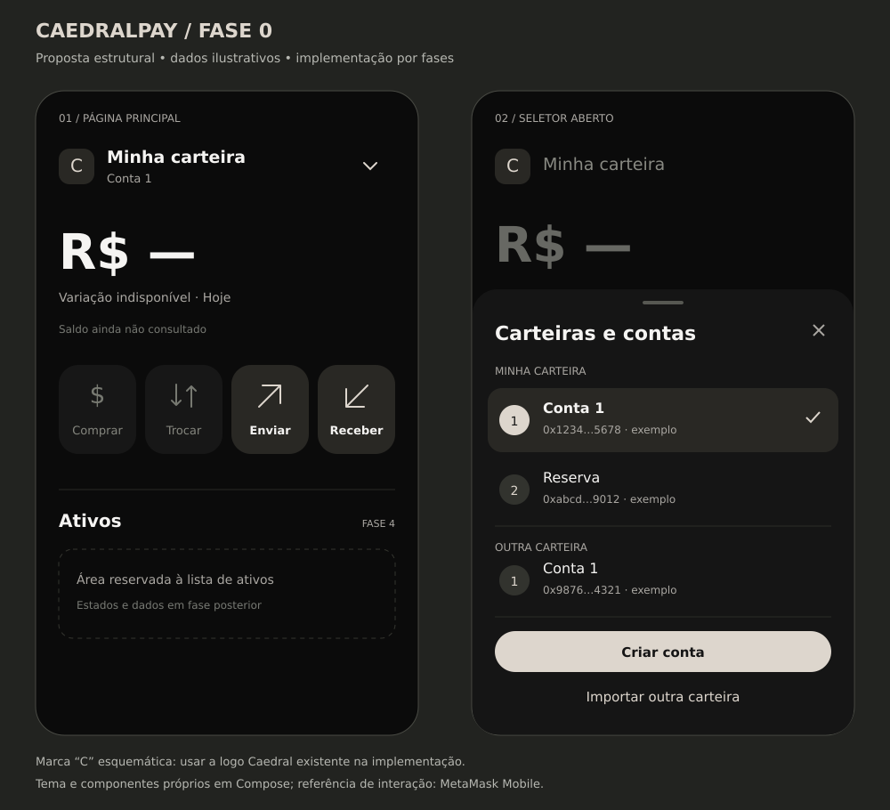

# Fase 0 — Estudo e contrato de reconstrução

Data: 11/11/2026. Branch: `fase/interface-principal`.

**Resultado:** estudo de código e proposta de reconstrução concluídos; apresentação visual proposta, ainda não implementada no aplicativo nem validada no A57.

**Atualização posterior à aprovação do desenho:** iniciada a implementação da composição abaixo no aplicativo. Inclui tema fixo Caedral, ícones próprios, página principal com quatro ações, seletor reconstruído e formulários de apoio. Comprar/Trocar permanecem desativados; Receber apresenta o endereço da conta ativa; Enviar abre um formulário sem execução de transação. A seção de ativos representa ausência de integração. Esta atualização não equivale à validação visual no A57, que permanece manual. Os comentários de referência MetaMask estão em `WalletHomeScreen.kt` e `WalletAccountsSheet.kt`.

## Direção recebida

O usuário rejeitou o visual atual e determinou que a página principal e suas interações sejam refeitas tomando a MetaMask como base. A marca, o tema escuro e o destaque mineral Caedral permanecem. As funções de selecionar/criar contas e importar carteiras continuam no escopo, com nova organização de apresentação. Criptografia, autenticação, derivação e infraestrutura da MetaMask não serão incorporadas.

A autorização relatada pelo usuário permite aproveitamento visual com créditos em comentários. Registrar os créditos no arquivo/componente efetivamente adaptado, sem atribuir à MetaMask a implementação do cofre Caedral ou afirmar certificação/auditoria do aplicativo. Até este estudo, nenhum trecho MetaMask foi incorporado ao código executável.

## O que foi examinado

Origem: [MetaMask Mobile, commit a216ff1](https://github.com/MetaMask/metamask-mobile/tree/a216ff1ef6c0af89eafbf8a19aab1a15b4b281af).

| Fonte examinada | Observação no código | Aplicação Caedral |
| --- | --- | --- |
| `Wallet/WalletHeader/WalletHeaderAccountPickerRow.tsx` | Nome limitado a uma linha, botão com identificação acessível e indicador de abertura | Seletor compacto, nome truncado apenas visualmente e rótulo acessível completo |
| `Views/AccountSelector/AccountSelector.tsx` | Seções de contas por carteira, seleção atual, estados distintos para lista e adição; seleção fecha o destino | Lista agrupada e navegação explícita entre selecionar, criar e importar |
| `BottomSheets/BottomSheetHeader/BottomSheetHeader.tsx` | Cabeçalho separa título e acessórios; arquivo marcado como obsoleto em favor do design system atual | Separar cabeçalho do conteúdo; usar Material 3 em vez de portar um componente obsoleto |
| `UI/AccountOverview/index.js` | Integração antiga com Redux/Engine e informações da conta | Referência histórica de organização; não transportar suas dependências |
| `Views/Wallet/index.tsx` | Composição de cabeçalhos, resumo de saldo, ações e seções em componentes especializados | Compor a página por blocos, sem um único arquivo controlar apresentação e operações |

O estudo foi por leitura dos arquivos, não por execução do aplicativo MetaMask. O repositório contém múltiplos layouts e variantes: não assumir que todo componente observado corresponde à versão da captura enviada pelo usuário. A captura e o pedido Caedral determinam a hierarquia visual deste recorte.

## Diagnóstico da implementação atual

| Arquivo/área | Constatação | Decisão |
| --- | --- | --- |
| `ui/theme/Theme.kt` | Cores dinâmicas habilitadas e paleta padrão roxa coexistem com cores fixas nas telas | Reconstruir o tema com tokens Caedral únicos |
| `WalletHomeScreen.kt` | Apresentação, leitura do snapshot e estado do painel ficam no mesmo composable; textos usados como ícones | Separar renderização/estado e usar ícones vetoriais consistentes |
| `WalletAccountsSheet.kt` | Selecionar, criar e importar estão condicionados por números de página; formulário inicial completo ocupa o painel | Estados nomeados e formulários próprios, com estrutura compartilhada de painel |
| Seletor atual | Itens usam caixas semelhantes e botões longos que competem com a lista | Linhas mais leves, seleção evidente e ações estáveis no rodapé |
| Resumo atual | Saldo ausente deixa a composição muito vazia; ausência de dados e mensagens repetem informação | Uma hierarquia principal e uma explicação curta por estado |
| `WalletVault.kt` / `WalletAccounts.kt` | Já oferecem criação/importação/seleção e snapshot público de contas | Conservar estas capacidades atrás de uma camada de estado; não reescrever segurança para mudar o visual |

Esse diagnóstico é de estrutura e apresentação por leitura do código; não substitui avaliação de desempenho, acessibilidade ou comportamento no aparelho.

## Contrato visual proposto



A imagem é um estudo estrutural próprio, não screenshot do app. Os nomes e endereços abreviados são exemplos; os valores desconhecidos permanecem indisponíveis. A seção de ativos indicada no desenho pertence à fase 4.

- Base escura `#0B0B0B`; painel `#151515`; superfície selecionada `#292824`; texto principal `#F5F4F2`; destaque `#DDD6CD`.
- Margens laterais iniciais de 24 dp, ritmo de espaçamento baseado em 4/8 dp e alvos interativos de pelo menos 48 dp. Valores a ajustar após teste com fontes ampliadas.
- Logo à esquerda; ao lado, seletor com nome da carteira e conta ativa em segundo nível. Indicador vetorial, alinhado ao seletor.
- Saldo BRL como informação dominante, abaixo do cabeçalho. Variação diária na linha seguinte; verde para ganho, vermelho para perda e neutro para indisponibilidade.
- Logo abaixo do resumo, uma fileira com quatro ações na ordem **Comprar, Trocar, Enviar e Receber**, conforme a correção do usuário. Quatro áreas de mesmo tamanho, ícones vetoriais com traço consistente e legenda; em telas estreitas/fontes ampliadas, permitir reorganização sem cortar os nomes.
- **Comprar e Trocar:** visíveis e desativados, com superfície/ícones/texto atenuados e sem resposta de toque. Na implementação, expor a semântica de desativado ao TalkBack; não remover os botões nem abrir fluxos dessas funções.
- **Enviar e Receber:** apresentação habilitada e destaque Caedral. Os destinos visuais passam a fazer parte do escopo; integração e execução de transações continuam separadas e não serão simuladas. A proposta não comprova disponibilidade operacional dos fluxos.
- Painel inferior com título, fechamento, lista de carteiras/contas e rodapé de ações. Lista rola independentemente do rodapé.
- Conta ativa identificada por marcador, tratamento de superfície e semântica de seleção, sem depender apenas da cor.
- Botão principal curto “Criar conta”; contexto da carteira aparece no formulário, evitando um botão com nome potencialmente longo.
- Formulários de criação e importação serão refeitos para a apresentação interna. Não encaixar a tela inicial inteira dentro do seletor.
- Fechar o painel e o gesto Voltar não alteram a seleção. Durante gravação, impedir reenvio e indicar carregamento na ação responsável.
- Sem botões de voltar permanentes nas telas; manter o gesto do sistema e fechamento contextual do painel, conforme os pedidos anteriores.

## Funções e estados a preservar

| Intenção da UI | API Caedral existente | Resultado esperado |
| --- | --- | --- |
| Abrir seletor | `WalletVault.accountsSnapshot()` | Apenas nomes, endereços e seleção pública chegam à apresentação |
| Trocar conta | `WalletVault.selectAccount(...)` | Atualizar cabeçalho e encerrar painel somente após persistir |
| Criar conta | `WalletVault.addAccount(...)` | Derivar próxima conta, salvar e selecionar; erro conserva estado anterior |
| Importar carteira | `WalletVault.importWallet(...)` | Validar frase, recuperar quantidade sequencial indicada e selecionar carteira importada |
| Cancelar | Evento local de apresentação | Nenhuma gravação nem troca de conta |
| Sair do app | Bloqueio já integrado à Activity/cofre | Encerrar sessão e exigir desbloqueio |

Estados previstos: `Lista`, `CriarConta`, `ImportarFrase`, `NomeEContas`, `Salvando` e `Falha`. São nomes do contrato, não classes implementadas nesta fase. Erros devem preservar os campos e permitir tentar novamente. Ao trocar conta, descartar dados de saldo/ativos da seleção anterior.

A recuperação de contas é sequencial e manual nesta etapa; não afirmar descoberta automática por saldo sem integração de rede. Importar frase duplicada conserva a carteira existente. A credencial temporária de importação fica fora do modelo visual da página principal e dos argumentos de navegação persistidos.

## Componentes da reconstrução

Nomes propostos, sujeitos à implementação da fase correspondente:

```text
ui/theme/                         tokens e tema Caedral
ui/components/                    botões, ícones, campos e mensagens
ui/home/WalletHomeContent          composição visual da página
ui/home/WalletHeader               marca + seletor
ui/home/WalletBalanceSummary       saldo + variação + estados
ui/home/WalletQuickActions         Comprar/Trocar desativados; Enviar/Receber
ui/accounts/AccountSelectorSheet   estrutura e lista do painel
ui/accounts/WalletAccountRow       linha de conta
ui/accounts/CreateAccountContent   formulário interno próprio
ui/accounts/ImportWalletContent    etapas internas próprias
```

Não criar todos os arquivos antecipadamente. Extrair cada componente quando sua fase for implementada e houver responsabilidade concreta. O estado/coordenador invoca as APIs Caedral e entrega modelos públicos e eventos à UI; os componentes visuais não derivam chaves nem reescrevem o arquivo do cofre.

## Créditos nos trechos aproveitados

Modelo de comentário para um arquivo/componente com adaptação efetiva:

```kotlin
/*
 * Referência/adaptação visual: MetaMask Mobile — ConsenSys Software Inc.
 * Fonte: https://github.com/MetaMask/metamask-mobile/blob/<commit>/<arquivo>
 * Alterações CaedralPay: <descrever a adaptação real para Compose e a marca>.
 * Autorização visual informada pelo responsável CaedralPay em 11/11/2026.
 * Este crédito refere-se à UI; não atribui o cofre Caedral à MetaMask.
 */
```

Substituir os marcadores pela origem exata e conservar os avisos originais aplicáveis quando houver transposição de código. Se houver somente observação de comportamento, descrever como referência, sem alegar cópia de um componente inteiro. Fontes e imagens de terceiros não estão automaticamente incluídas nesse registro visual; a proposta usa tipografia do sistema e a marca Caedral existente.

## Validação e passagem para implementação

- Estudo de referência e diagnóstico: concluídos por leitura de código.
- Inventário de funções e mapa de reconstrução: concluídos.
- Proposta visual estrutural: produzida; validação do usuário pendente.
- Execução no A57: não realizada nesta fase.
- Nenhuma mudança no código executável, dependências, cofre ou carteira armazenada foi necessária para esta entrega.

A próxima fase é a fundação visual: cores, tipografia, ícones, botões e estrutura de painel. Em seguida, reconstruir cabeçalho/resumo e seletor, cada um com build e teste manual. O visual anterior não é a referência a preservar.
